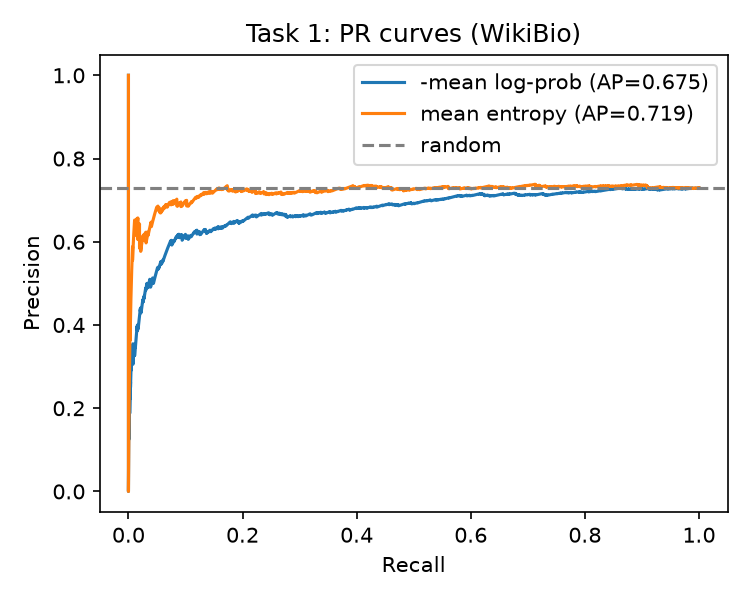
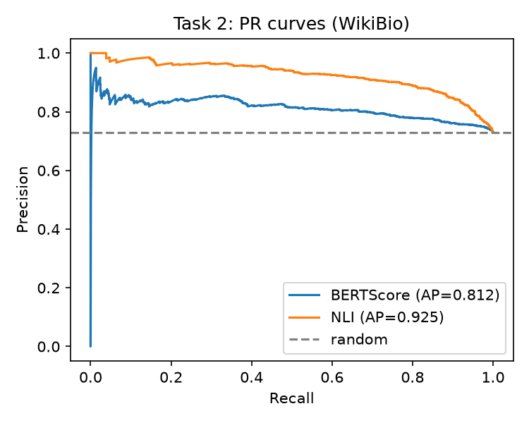
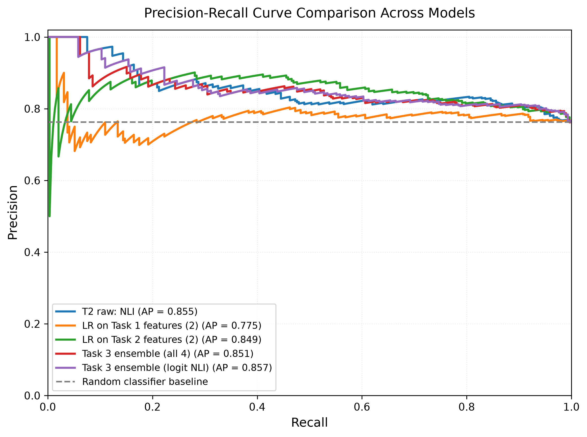

# REPORT: NLP (CS60075) Assignment-2 | Project 7 + WikiBio GPT-3 Hallucination Dataset

**Project 7: Do LLMs Know When They're Making Things Up?**

**Group members**

| Name | Roll number |
|---|---|
| Shibhaditya Dohare | 22EE38014 |
| Shivraj Anand | 25CS92P07 |
| Avinash | 24CS10009 |

---

## Summary

We study three ways of detecting hallucinated sentences in GPT-3-generated biographies (WikiBio GPT-3 Hallucination Dataset), all evaluated with AUC-PR (hallucinated = positive class):

1. **Task 1** scores each sentence with the token probabilities of an open LLM (Qwen3-8B). This baseline is no better than random.
2. **Task 2** reproduces SelfCheckGPT (BERTScore and NLI variants) against the 20 supplied resamples. SelfCheck-NLI is a strong detector.
3. **Task 3** stacks all four features with a logistic regression. On a held-out 20% of passages, the stack with a logit-transformed NLI feature clearly beats the plain linear ensemble but does not beat raw SelfCheck-NLI.

| Method | AUC-PR, full dataset (Tasks 1 and 2) | AUC-PR, held-out 20% (Task 3 protocol) |
|---|---|---|
| Random baseline (positive rate) | 0.7296 | 0.7624 |
| Task 1: -mean log-probability | 0.6747 | 0.7101 |
| Task 1: mean entropy | 0.7194 | 0.7189 |
| Task 2: SelfCheck-BERTScore | 0.8125 | 0.8148 |
| Task 2: SelfCheck-NLI | 0.9250 | 0.9306 |
| Task 3: ensemble, 4 features | - | 0.9073 |
| Task 3: ensemble, 4 features with logit NLI | - | 0.9245 |

---

## 1. Dataset and preprocessing

**Dataset.** `potsawee/wiki_bio_gpt3_hallucination` (Manakul et al., 2023). It contains 238 GPT-3-generated biographies split into sentences. Each sentence carries a human accuracy label (`accurate`, `minor_inaccurate`, `major_inaccurate`), and each passage comes with 20 independently resampled passages (temperature 1.0).

**Preprocessing** (`data.ipynb`):
- The three-way label is binarised: `accurate` is negative (0), `minor_inaccurate` and `major_inaccurate` are positive (1).
- Sentences and annotations are kept index-aligned. Passages where the two lists differ in length would be logged and dropped.
- This gives **1,908 sentences**, of which **72.96% are positive**. Since the positive class is the majority, a random scorer already gets AUC-PR of about 0.73, and all results must be read against that baseline, not against 0.5.
- The 20 resamples are stored once per passage (not repeated per sentence).
- **Train/test split for Task 3:** 80/20 with seed 42, done **by passage** (190 train and 48 test passages), so sentences of one passage never appear in both parts. An assertion checks that the passage sets are disjoint. The held-out part has a positive rate of 0.7624.

Tasks 1 and 2 use the full dataset because their scoring methods are formulas, not trained models.

---

## 2. Task 1: probability-based baseline

### Method
- **Model:** `Qwen/Qwen3-8B` in bfloat16, used as a proxy (it did not write the text).
- **Forced decoding.** Each sentence is scored given a fixed prefix ("Here is a short Wikipedia-style biography.") followed by all earlier sentences of the same passage (as written by GPT-3). Only the sentence's own tokens are scored; the prefix and context are not.
- **Features:** the mean token log-probability, and the mean predictive entropy (entropy of the full next-token distribution, averaged over the sentence's tokens).
- **Scores:** the negative mean log-probability and the mean entropy, so that higher always means more likely hallucinated. Nothing is trained.

### Results (full dataset, 1,908 sentences)

| Score | AUC-PR | ROC-AUC |
|---|---|---|
| Random baseline | 0.7296 | 0.5000 |
| -mean log-probability | 0.6747 | 0.4332 |
| Mean entropy | 0.7194 | 0.4994 |

| Label | Mean log-prob (mean / median / std) | Mean entropy (mean / median / std) | Tokens per sentence |
|---|---|---|---|
| 0 (accurate) | -1.168 / -1.069 / 0.618 | 0.936 / 0.891 / 0.402 | 26.1 |
| 1 (hallucinated) | -1.011 / -0.944 / 0.472 | 0.919 / 0.880 / 0.349 | 26.0 |

### Discussion
- **Neither score beats random.** Entropy is at chance (ROC-AUC 0.4994) and log-probability is below the baseline.
- **The log-probability signal is inverted.** Hallucinated sentences get a *higher* mean log-probability than accurate ones, so Qwen finds them more predictable. We kept the direction specified in the assignment and did not flip it.
- **Likely explanation (our interpretation, not tested here).** GPT-3's wrong sentences are fluent and often generic, which any language model predicts easily. Accurate sentences more often contain specific facts (names, dates, places) that a proxy model cannot predict. Token probability therefore measures fluency and genericness, not truth.
- **Sentence length is not the cause:** both classes average about 26 tokens.
- **Context did not rescue the baseline.** An earlier run that scored each sentence *in isolation* gave AUC-PR 0.6910 (log-probability) and 0.7155 (entropy). Adding context lowered the average log-probability from about -2.3 to about -1.1 but did not change the conclusion.

---

## 3. Task 2: SelfCheckGPT reproduction

### Method
Following Manakul et al. (2023), a sentence that is true should be consistent with independent resamples of the same passage. We use the 20 resamples supplied with the dataset (nothing was regenerated).

- **SelfCheck-BERTScore.** Each resample is split into sentences with spaCy. For a scored sentence, take the maximum BERTScore-F1 against the sentences of each resample, average over the 20 resamples, and return `1 - mean`. We use `roberta-large` with the `bert_score` defaults (layer 17, baseline rescaling).
- **SelfCheck-NLI.** The input pair is (sentence, whole resampled passage), with the sentence as the hypothesis and the resample as the premise. The score is P(contradiction), averaged over the 20 resamples.
- **NLI checkpoint (deviation from the assignment text).** The assignment names `microsoft/deberta-v3-large-mnli`. We could not find a checkpoint with that ID and used `potsawee/deberta-v3-large-mnli`, which is the one in the SelfCheckGPT code. It has a two-way head (entail, contradict) with the neutral class removed, so P(contradiction) is already normalised as in the paper.

### Results (full dataset)

### 1. Overall Performance Comparison

| Method              | AUC-PR ↑ | ROC-AUC ↑ |
| ------------------- | -------- | --------- |
| Random Baseline     | 0.7296   | 0.5000    |
| SelfCheck-BERTScore | 0.8125   | 0.6484    |
| SelfCheck-NLI       | 0.9250   | 0.8369    |

### 2. Score Distribution by Ground-Truth Label

| Label            | Metric                  | Mean  | Median | Std. Dev. |
| ---------------- | ----------------------- | ----- | ------ | --------- |
| Accurate (0)     | BERTScore Inconsistency | 0.550 | 0.597  | 0.182     |
| Accurate (0)     | NLI Contradiction       | 0.511 | 0.514  | 0.298     |
| Hallucinated (1) | BERTScore Inconsistency | 0.637 | 0.657  | 0.135     |
| Hallucinated (1) | NLI Contradiction       | 0.850 | 0.927  | 0.198     |

### 3. Score Distribution by Annotation Category

| Annotation       | BERTScore Inconsistency ↑ | NLI Contradiction ↑ |
| ---------------- | ------------------------- | ------------------- |
| Accurate         | 0.550                     | 0.511               |
| Minor Inaccurate | 0.584                     | 0.811               |
| Major Inaccurate | 0.681                     | 0.883               |

Note: Higher inconsistency and contradiction scores indicate stronger evidence of hallucination.

### Discussion
- **Both variants beat the random baseline; NLI by a wide margin.** BERTScore gains about 0.08 AUC-PR, NLI about 0.20. On the PR curve, NLI holds precision around 0.95 or higher up to roughly 40% recall, while BERTScore stays around 0.82 to 0.85.
- **The numbers are close to published ones.** The SelfCheckGPT repository reports about 81.96 (BERTScore) and 92.50 (NLI) AUC-PR in this setting, against our 0.8125 and 0.9250. We take this as evidence that the implementation is faithful. (We took the published figures from the repository's README and recommend checking them against the paper.)
- **NLI is stronger because it detects contradiction.** BERTScore only measures similarity of wording, so a wrong sentence on the same topic can still look similar to the resamples.
- **The scores order the labels as the method predicts.** Both rise from accurate to minor to major inaccuracy.
- **Distributions.** NLI is heavily skewed towards 1 (median 0.878), which is natural because most sentences are hallucinated. BERTScore ranges up to 1.03 because of baseline rescaling. The thin vertical spike at recall 0 on the BERTScore curve comes from a few top-ranked sentences and has no meaning.

---

## 4. Task 3: stacked ensemble detector

### Method
- **Split:** the passage-level 80/20 split from Section 1 (seed 42).
- **Features:** Task 1 (mean log-probability, mean entropy) and Task 2 (BERTScore inconsistency, NLI contradiction).
- **Meta-classifier:** logistic regression on standardised features, fitted on the 80% train part only. The regularisation strength `C` is chosen by 5-fold cross-validation grouped by passage (scored by average precision), so sentences of one passage never fall in both an inner-train and an inner-validation fold.
- **Evaluation:** AUC-PR on the held-out 20%, with every method recomputed on the same sentences.

### Results on the held-out 20% (48 passages)

| Method | AUC-PR | ROC-AUC |
|---|---|---|
| Random baseline (positive rate) | 0.7624 | 0.5000 |
| **Task 1** raw: -mean log-probability | 0.7101 | 0.4445 |
| **Task 1** raw: mean entropy | 0.7189 | 0.4438 |
| **Task 1** logistic regression (2 features) | 0.7754 | 0.5389 |
| **Task 2** raw: BERTScore | 0.8148 | 0.6260 |
| **Task 2** raw: NLI | 0.9306 | 0.8251 |
| **Task 2** logistic regression (2 features) | 0.8997 | 0.8070 |
| **Task 3** ensemble, all 4 features | 0.9073 | 0.7992 |
| **Task 3** ensemble, all 4 features with logit NLI (see Section 5) | 0.9245 | 0.8150 |

### Discussion
- **Task 1 features are weak alone.** A logistic regression on them reaches 0.775 on the test split, only slightly above the 0.762 baseline, because it can learn the sign of each feature.
- **Task 2 features carry nearly all of the signal.** NLI alone reaches 0.9306 with no training.
- **The plain four-feature ensemble gives a small, unreliable gain** over the Task 2 logistic regression (0.9073 against 0.8997); see the bootstrap in Section 5.
- **A logit transform of the NLI feature helps clearly** (0.9245), and the ensemble is then roughly on par with, but not above, raw NLI.

---

## 5. Additional analyses (beyond the assignment)

The following were **not required** by the assignment and are added to make the Task 3 comparison more reliable. They are reported as supplementary.

**5.1 Logit-transformed NLI (post-hoc improvement).** Raw NLI probabilities pile up near 0 and 1, which a linear model on the raw values handles poorly. We replaced the NLI feature by its logit (probability clipped to [1e-4, 1 - 1e-4]) and refitted the same logistic regression. **This variant was chosen after seeing the results of the first ensemble**, so it is a post-hoc choice; both ensembles are reported side by side for that reason.

**5.2 Logistic regressions on each feature subset.** The Task 1 and Task 2 rows labelled "logistic regression" give the single-task methods the same trained model as the ensemble, so that the ensemble is not the only method to benefit from learning on labels.

**5.3 Bootstrap over test passages** (1,000 resamples of the 48 test passages with the fitted models held fixed; passages, not sentences, are resampled because sentences within a passage are correlated):

| Method | AUC-PR (test) | 95% CI |
|---|---|---|
| Task 1 raw: mean entropy | 0.7189 | [0.6361, 0.8207] |
| Task 1 logistic regression | 0.7754 | [0.6980, 0.8582] |
| Task 2 raw: NLI | 0.9306 | [0.8897, 0.9648] |
| Task 2 logistic regression | 0.8997 | [0.8364, 0.9515] |
| Task 3 ensemble (all 4) | 0.9073 | [0.8531, 0.9522] |
| Task 3 ensemble (logit NLI) | 0.9245 | [0.8804, 0.9609] |

| Paired comparison | Mean AUC-PR difference | 95% CI | Resamples where the first is better |
|---|---|---|---|
| Ensemble (all 4) minus Task 2 logistic regression | +0.0066 | [-0.0097, +0.0246] | 78.7% |
| Logit ensemble minus ensemble (all 4) | +0.0165 | [+0.0052, +0.0305] | 100% |
| Logit ensemble minus raw NLI | -0.0061 | [-0.0127, -0.0007] | 0.9% |

**5.4 Grouped 5-fold cross-validation on all 238 passages** (fixed `C = 1`; random baseline 0.7296):

| Method | AUC-PR |
|---|---|
| Task 1 logistic regression | 0.7489 |
| Task 2 logistic regression | 0.9000 |
| Task 3 ensemble (all 4) | 0.9059 |
| Task 3 ensemble (logit NLI) | 0.9232 |

**Reading the supplementary results.**
- The plain ensemble's gain over the Task 2 logistic regression is within noise (interval includes zero), and cross-validation agrees (+0.006).
- The logit transform is a real improvement over the plain ensemble: +0.0165 on the test split with an interval above zero, and +0.0173 in cross-validation.
- The ensemble does **not** beat zero-shot NLI. On the test split raw NLI is slightly but consistently better (difference -0.0061, interval below zero). On the full dataset, raw NLI (0.9250, Task 2) and the cross-validated logit ensemble (0.9232) are essentially tied.

---

## 6. Overall conclusions

1. **Token probabilities are not reliable hallucination detectors on this dataset.** Both Task 1 scores are at or below the random baseline, and log-probability is inverted, plausibly because GPT-3's wrong sentences are fluent and generic.
2. **Resampling consistency works.** SelfCheck-NLI reaches 0.925 AUC-PR on the full dataset, close to the published result, and BERTScore reaches 0.8125. NLI is much stronger because it detects contradiction, not just similarity.
3. **Stacking helps only after a suitable feature transform and does not beat zero-shot NLI.** The plain ensemble gives a small, uncertain gain over Task 2 alone; the logit-NLI ensemble clearly improves on the plain ensemble but only matches raw NLI. In this setting, resampling consistency dominates and the probability features add no measurable gain.

## 7. Limitations

- **Small test set.** The held-out part has only 48 passages, so differences in the third decimal place are noise. The cross-validation on all passages is a more stable estimate.
- **Bootstrap scope.** It resamples test passages with the models held fixed and captures test-set noise, not variation from retraining.
- **Post-hoc variant.** The logit transform was chosen after viewing the first ensemble's results.
- **Proxy model.** Task 1 uses Qwen3-8B, not GPT-3. Probabilities from the generating model might behave differently, so the Task 1 result is specific to this model and setup. Earlier sentences in the context are GPT-3's own and may be wrong.
- **Fixed resamples.** Task 2 uses the dataset's 20 supplied resamples and no others.
- **Binary label.** Minor and major inaccuracies are merged for AUC-PR. The three-way means in Section 3 suggest major errors are easier to detect.
- **Fixed regularisation in cross-validation.** The cross-validation check uses `C = 1`, whereas the test-split models tune `C`.
- **One dataset.** All conclusions concern WikiBio; the other datasets mentioned in the assignment were not used.

## 8. Reproducibility

Code, environment files, library versions, hardware details and the project structure are described in `README.md`. The notebooks are run in this order: `data.ipynb`, `task1.ipynb`, `task2.ipynb`, `task3.ipynb`. All random choices use seed 42, and the intermediate features are saved in `results/` (`task1_wikibio.csv`, `task2_wikibio.csv`, `task3_summary.csv`).

---

## References

1. Manakul, P., Liusie, A., and Gales, M. J. F. (2023). *SelfCheckGPT: Zero-Resource Black-Box Hallucination Detection for Generative Large Language Models.* arXiv:2303.08896. Code: https://github.com/potsawee/selfcheckgpt
2. Lebret, R., Grangier, D., and Auli, M. (2016). *Neural Text Generation from Structured Data with Application to the Biography Domain.* EMNLP. arXiv:1603.07771. (Source of the WikiBio biographies.)
3. Yang, A. et al. (2025). *Qwen3 Technical Report.* arXiv:2505.09388.
4. Zhang, T., Kishore, V., Wu, F., Weinberger, K. Q., and Artzi, Y. (2020). *BERTScore: Evaluating Text Generation with BERT.* ICLR. arXiv:1904.09675.
5. Liu, Y. et al. (2019). *RoBERTa: A Robustly Optimized BERT Pretraining Approach.* arXiv:1907.11692.
6. He, P., Gao, J., and Chen, W. (2021). *DeBERTaV3: Improving DeBERTa using ELECTRA-Style Pre-Training with Gradient-Disentangled Embedding Sharing.* arXiv:2111.09543.
7. Williams, A., Nangia, N., and Bowman, S. R. (2018). *A Broad-Coverage Challenge Corpus for Sentence Understanding through Inference (MultiNLI).* NAACL. arXiv:1704.05426.
8. Pedregosa, F. et al. (2011). *Scikit-learn: Machine Learning in Python.* JMLR 12, 2825-2830.